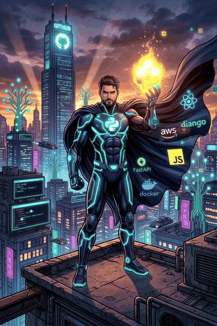

<!-- Profile README for github.com/shantanu-983 -->

# Hey, I'm Shantanu Pandey 👋

### Computer Science Engineering Student | Aspiring Software Developer

I enjoy solving problems with code, building clean web experiences, and exploring how AI can make software more useful.

---

## 👨‍💻 About Me

- 🎓 Pursuing a **B.Tech in Computer Science Engineering**.
- 🧩 Practising **Data Structures and Algorithms in C++**.
- 🌐 Building my foundations in **frontend and web development**.
- 🤖 Exploring **AI, Generative AI, and practical LLM applications**.
- 🚀 Interested in turning project ideas into useful, deployable products.
- 📍 Based in India.

---

## 🚀 My Developer Journey

  

---

## 🛠️ Tech Stack

### Languages

  

### Web Development

  

### Cloud & DevOps

  

Currently learning cloud fundamentals through **AWS Academy Cloud Foundations** and hands-on exploration in the AWS Academy sandbox.

### Tools

  

> Currently strengthening my fundamentals. The icons represent technologies I use or am learning—not a claim of expert-level proficiency.

## 🌱 Currently Learning

- Writing more efficient solutions to DSA problems
- Responsive interfaces and modern JavaScript
- AI/GenAI fundamentals and practical applications
- AWS cloud fundamentals and core cloud services
- Core computer science concepts for software engineering interviews

## 🚧 Projects

- **AI-Powered Smart Agriculture Advisory & Market Intelligence Platform** — a student project exploring mandi selling decisions, crop opportunities, climate risks, and relevant government support.
- **Baba Departmental Store** — a responsive e-commerce-style frontend for a local departmental store.

Explore my repositories for code, progress, and project details: **[github.com/shantanu-983](https://github.com/shantanu-983?tab=repositories)**

## 📊 GitHub Overview

  
  
   
  

## 🤝 Connect

- **GitHub:** [@shantanu-983](https://github.com/shantanu-983)
- **LinkedIn:** [@SHANTANU PANDEY](www.linkedin.com/in/shantanu-pandey-b8067530a)
- **Portfolio:** Add your portfolio URL when ready
- **Email:** Add a public contact email if you want recruiters to reach you

---

  <i>Learn consistently. Build thoughtfully. Improve every day.</i>

